# «Meine Fassung» – Kurzanleitung

Mit «Meine Fassung» passen Sie eine fertige Einheit auf bbw-hko.ch an Ihre Klasse an. Das Original bleibt unverändert. Ihre Fassung sehen nur Sie und KT1.

**Wo es geht:** nur bei Einheiten im neuen Format (v4.2), zum Beispiel «Konsum verantworten (v4.2)» oder «Sich im Lehrvertrag orientieren (v4.2)».

Die Bilder zeigen meist die EFZ-Einheit «Konsum verantworten». Einige Bilder ab Schritt 4 stammen aus der EBA-Einheit «Sich im Lehrvertrag orientieren»; der Ablauf ist derselbe. Was bei EBA anders ist, steht am Schluss.

**Zwei Wege:**

- **Mit Modell:** Sie schreiben, was anders werden soll. Ein Sprachmodell macht einen Vorschlag. Sie entscheiden Stück für Stück.
- **Selbst bearbeiten:** Sie ändern einen Text direkt. Es geht nichts an ein Sprachmodell.

---

## 1  Die Leiste finden

Öffnen Sie die Einheit. Über der Vorschau des Hefts steht die Leiste **Meine Fassung**. Der grüne Kasten erklärt, was mit Ihren Eingaben geschieht.

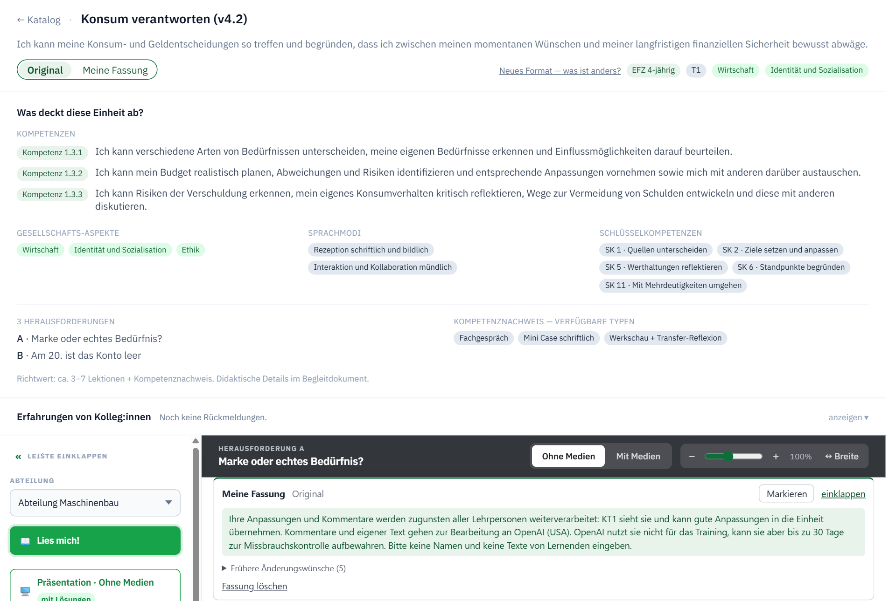

## 2  Teile markieren

Klicken Sie auf **Markieren**. Alle Teile, die Sie ändern können, sind jetzt gestrichelt umrandet. Klicken Sie auf einen solchen Block.

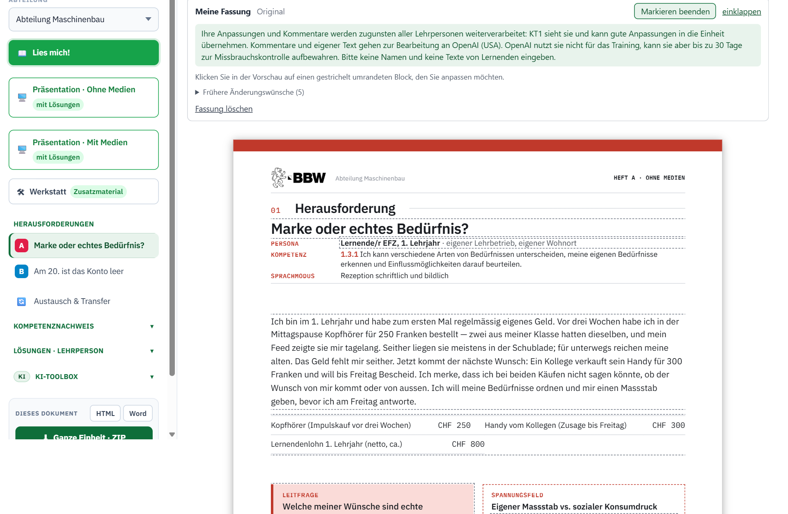

## 3  Auftrag wählen und Wunsch beschreiben

Es öffnet sich ein kleines Fenster. Unter **Was möchten Sie tun?** wählen Sie, was zum Block passt:

- **Selbst bearbeiten (ohne Modell)**
- **Leitfrage umformulieren** – die gespeicherte Lösung bleibt und muss weiter passen
- **Situation umformulieren** – Person, Betrieb und Fall; Lösungen und Beispiel ziehen mit
- **Handlungsprodukt ändern** – Schritte, Kriterien und Beispiel ziehen mit
- **Eigenen Text verwenden** – siehe Schritt 7

Welche Aufträge erscheinen, hängt vom Block ab. Schreiben Sie unter **Was soll anders werden?** kurz Ihren Wunsch. Lesen Sie den Hinweis zu OpenAI. Dann **Hinzufügen**.

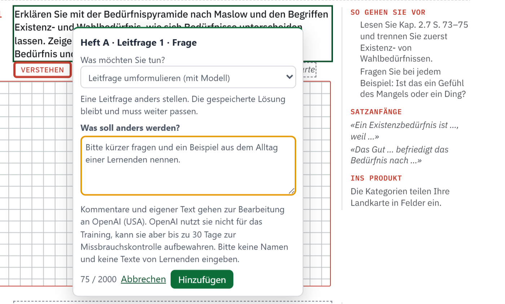

## 4  Wünsche sammeln und abschicken

Sie können mehrere Blöcke markieren. Die Wünsche sammeln sich in der Leiste unter **Änderungswünsche Heft A** (bzw. Heft B). Mit **entfernen** streichen Sie einen Wunsch. Sind alle beisammen: **Änderungswünsche Heft A abschicken**.

Danach steht «Vorschlag wird erstellt …». Das dauert meist 1–3 Minuten. Lassen Sie die Seite offen.

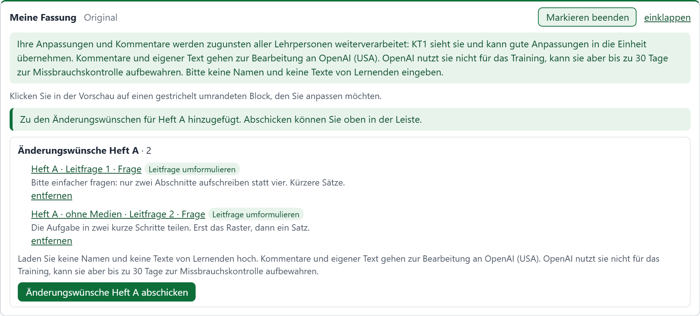

## 5  Vorschlag prüfen und speichern

Die Seite zeigt jetzt die **Vorschau eines Vorschlags**. Für jeden geänderten Teil steht eine kurze Begründung. Entscheiden Sie Stück für Stück: **Übernehmen** oder **Verwerfen**. Ein Klick auf den unterstrichenen Namen springt zur Stelle im Heft.

**Wichtig:** Übernommen ist erst, was Sie mit **Entscheid speichern** sichern.

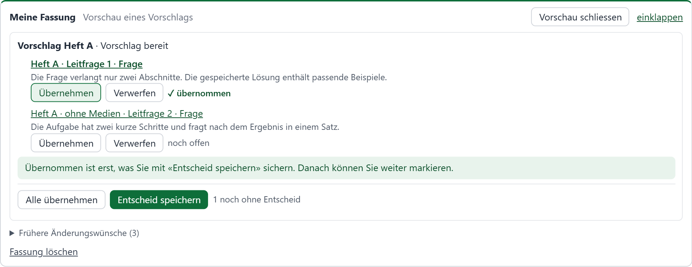

Im Heft sind die vorgeschlagenen Stellen grün hinterlegt.

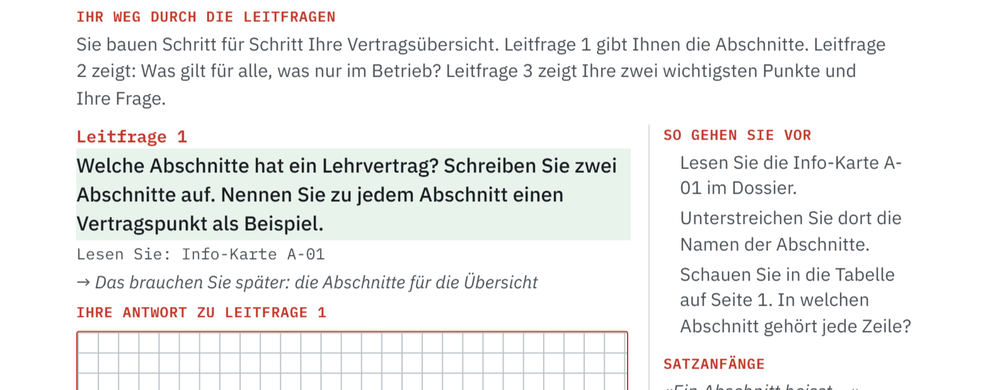

## 6  Selbst bearbeiten (ohne Modell)

Für kleine Änderungen brauchen Sie kein Modell. Markieren Sie den Block und wählen Sie **Selbst bearbeiten (ohne Modell)**. Ändern Sie den Text direkt im Feld. Unten zählt der Zähler die Zeichen (z. B. «174 / 184 Zeichen»): mehr hat im Heft keinen Platz. Dann **Speichern**.

Passen Sie zusammenhängende Stellen (Lösungen, anderes Heft) bei Bedarf selbst an.

**Zurück zum Original:** Öffnen Sie denselben Block wieder mit «Selbst bearbeiten» und klicken Sie auf **Original einsetzen**. Nach **Speichern** gilt wieder das Original.

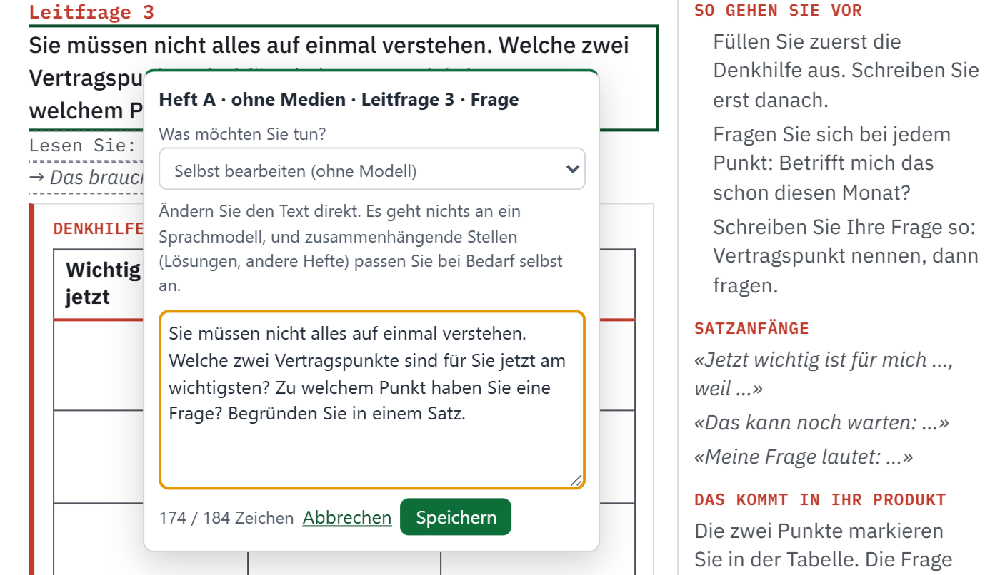

## 7  Eigener Text als Grundlage

Sie möchten die Leitfragen auf einen eigenen Text stützen, z. B. einen Zeitungsartikel? Wählen Sie bei einer Leitfrage **Eigenen Text verwenden**. Im selben Fenster laden Sie eine Datei hoch (.docx, .pdf oder .txt, höchstens 5 MB) **oder** fügen den Text ein. Schreiben Sie darunter, was mit dem Text passieren soll. Dann **Hinzufügen** und abschicken wie in Schritt 4.

Das gilt nur für das Heft **ohne Medien**.

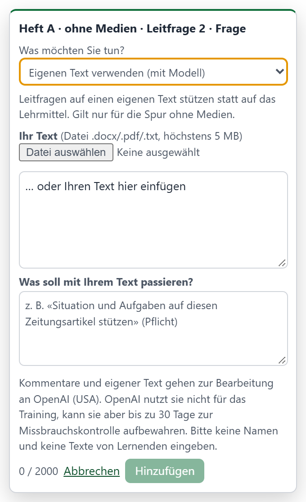

## 8  Die eigene Fassung ansehen

Oben beim Titel wechseln Sie zwischen **Original** und **Meine Fassung**. In Ihrer Fassung steht der Vermerk «angepasst, nicht von KT1 geprüft». Er erscheint auch in den Dokumenten.

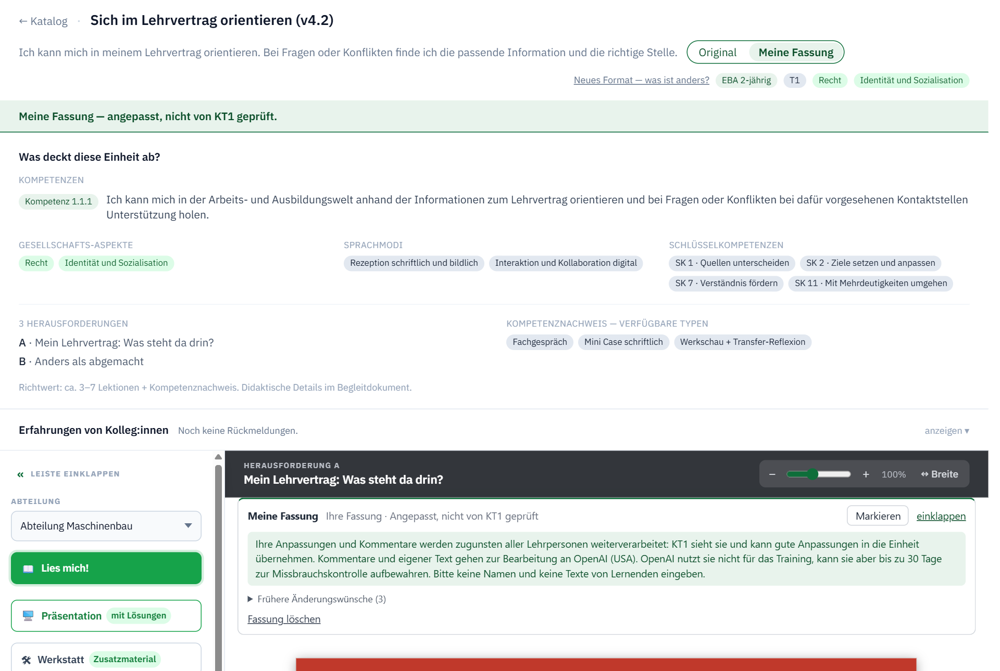

## 9  Herunterladen

In Ihrer Fassung heisst der Knopf links unten **Meine Fassung · ZIP**. Er lädt die ganze Einheit mit Ihren Änderungen herunter.

## 10  Verlauf und Fassung löschen

Unter **Frühere Änderungswünsche** sehen Sie alle Runden. Ein Vorschlag, den Sie noch nicht entschieden haben, öffnen Sie dort mit **Vorschau**.

**Fassung löschen** entfernt Ihre ganze Fassung mit allen Runden. Der Browser fragt nach. Das lässt sich nicht rückgängig machen. Danach sehen Sie wieder das Original.

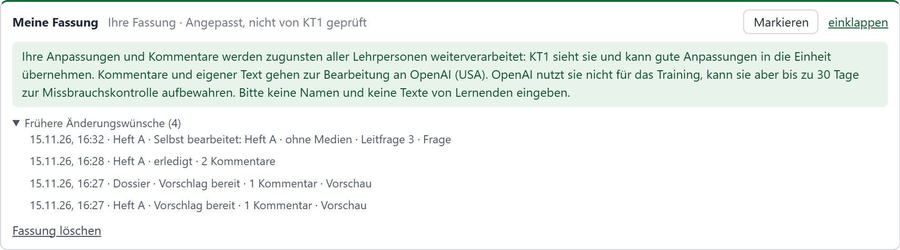

## EBA-Einheiten

Die Leiste steht an derselben Stelle über der Vorschau. Markieren, Abschicken, Prüfen und Speichern gehen gleich. Anders ist:

- **Eine Spur:** Die EBA-Hefte haben keinen Umschalter «Ohne Medien / Mit Medien».
- **Sprache:** Das Modell schreibt für EBA auf Niveau A2, mit kurzen Sätzen.
- **Dossier nicht markierbar:** Dossier und Lese-Arbeitsblatt haben keine gestrichelten Blöcke. Ein Klick dort meldet «Diesen Teil kann man nicht anpassen». Auch «Selbst bearbeiten» geht nur in Heft A, Heft B und im Auftragsbogen.
- **Dossier zieht mit:** Wählen Sie im Heft **Situation umformulieren**, **Handlungsprodukt ändern** oder **Eigenen Text verwenden**, passt das Modell das Dossier in einem eigenen Schritt an. Sie bekommen dann zwei Vorschläge: zuerst für das Heft, danach für das Dossier. Nach «Entscheid speichern» springt die Leiste zum nächsten offenen Vorschlag. Der Schritt für das Dossier zählt als eigener Aufruf zur Tagesgrenze.
- **Leitfrage umformulieren** und **Selbst bearbeiten** ändern das Dossier nicht.

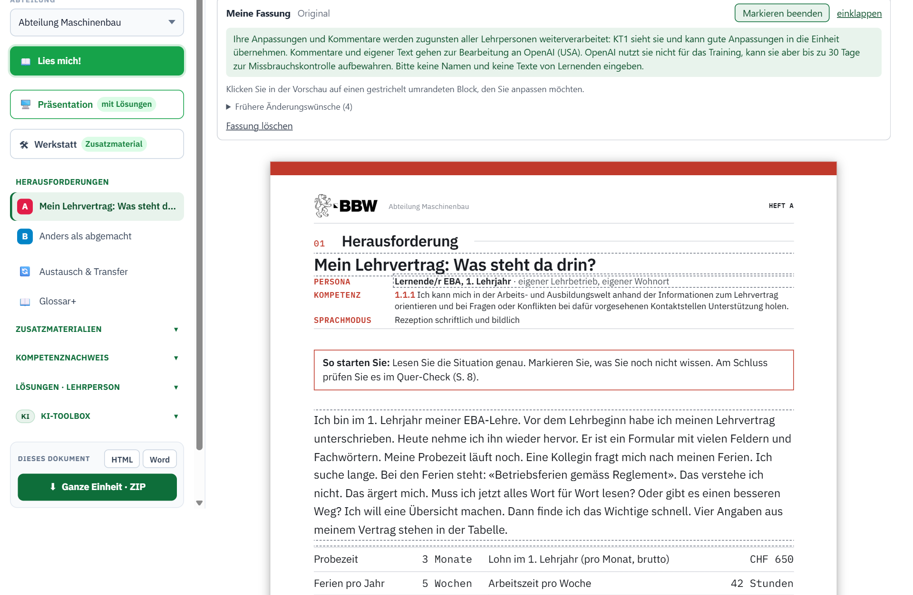

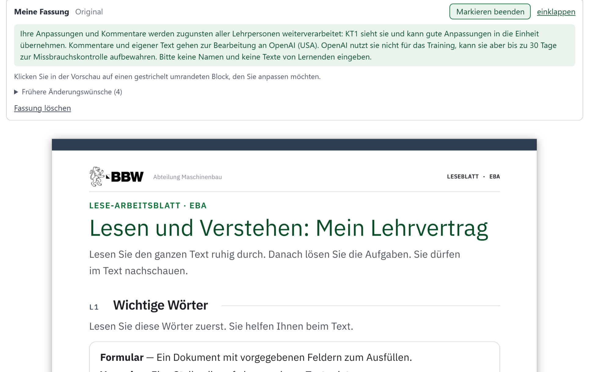

---

> **Gut zu wissen**
>
> - **Datenschutz:** Kommentare und eigener Text gehen zur Bearbeitung an **OpenAI (USA)**. OpenAI nutzt sie **nicht für das Training**, kann sie aber **bis zu 30 Tage** zur Missbrauchskontrolle aufbewahren. **Keine Namen und keine Texte von Lernenden eingeben.** «Selbst bearbeiten» schickt nichts an OpenAI.
> - **KT1 liest mit:** KT1 sieht Ihre Anpassungen und kann gute davon in die Einheit übernehmen.
> - **Grenze:** höchstens **20 Aufrufe** des Modells pro Tag und Person.
> - **Rückmeldung:** Etwas klemmt oder ist unklar? Unten rechts auf jeder Seite: **Problem melden**.
>
> 
